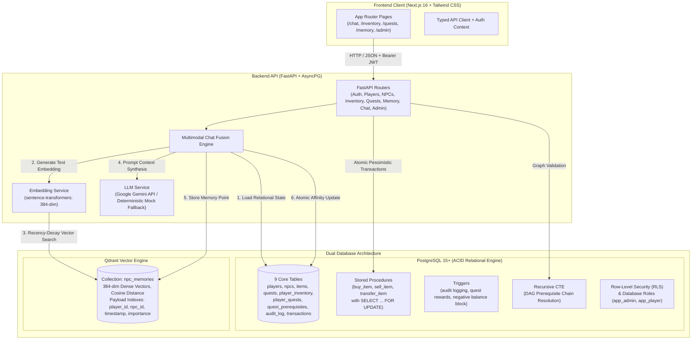

# Generative NPC Memory Engine 🎮🧠
**PES University — Advanced Database Management Systems (DBMS) Level 3 Mini-Project**
*Target: 50/50 on DBMS Evaluation Rubric*

---

## 📌 Executive Summary

The **Generative NPC Memory Engine** is a high-performance, exploit-proof game backend and interactive dashboard where players converse with non-player characters (NPCs) that possess persistent, cross-session memories.

The system combines **PostgreSQL** for relational ACID state management (currency, inventory, quest DAGs, audit logs) and **Qdrant** for high-dimensional vector search (384-dimensional dense semantic conversation memory). At every dialogue turn, the engine dynamically executes a **Multimodal Fusion Pipeline**:
1. Queries ACID relational state (player gold, active quests, relationship affinity score).
2. Performs cosine-similarity semantic vector search over past dialogue filtered by tenant isolation and weighted by recency decay.
3. Fuses both contexts into an LLM synthesis prompt.
4. Stores the generated interaction and atomically updates relational sentiment heuristics.

---

## 🏆 Rubric Compliance Matrix (50 / 50 Marks)

| # | Rubric Item | Marks | Implementation & Files |
|---|-------------|:-----:|------------------------|
| 1 | **ER Diagram** | 2 | [`docs/ER_DIAGRAM.md`](docs/ER_DIAGRAM.md) — 9 Entities, Crow's Foot Cardinalities, Primary & Foreign Keys |
| 2 | **Relational Schema** | 3 | [`docs/SCHEMA.md`](docs/SCHEMA.md) — 3NF Normalization proofs, functional dependencies, integrity constraints |
| 3 | **SQL DDL & Constraints** | 4 | [`db/schema.sql`](db/schema.sql), [`db/migrations/`](db/migrations/) — PK, FK, CHECK (`gold >= 0`, `quantity >= 0`, `level > 0`), UNIQUE, NOT NULL, DEFAULT, B-Tree & GIN indexes |
| 4 | **Qdrant Vector Creation** | 4 | [`db/qdrant_setup.py`](db/qdrant_setup.py) — 384-dim, Cosine distance, payload schema (`player_id`, `npc_id`, `timestamp`, `importance`), payload indexers |
| 5 | **Technology Justification** | 1 | [`docs/TECH_JUSTIFICATION.md`](docs/TECH_JUSTIFICATION.md) — Deep technical comparison: ACID relational vs Unstructured Vector Search |
| 6 | **DML Operations** | 4 | [`db/seed.sql`](db/seed.sql), [`db/demo_queries.sql`](db/demo_queries.sql) — Real-world parameterized INSERT, UPDATE, DELETE, and SELECT queries |
| 7 | **Advanced SQL Queries** | 4 | [`db/demo_queries.sql`](db/demo_queries.sql) — Multi-table INNER/LEFT JOINs, GROUP BY / HAVING, correlated subqueries, and **Recursive CTE** DAG traversal |
| 8 | **Procedures, Triggers, Views & FTS** | 6 | [`db/procedures.sql`](db/procedures.sql) (`buy_item`, `sell_item`, `transfer_item` with `FOR UPDATE` pessimistic locks), [`db/triggers.sql`](db/triggers.sql) (audit logging, quest rewards, exploit guard), [`db/views.sql`](db/views.sql) (`player_leaderboard`, `npc_popularity`, `quest_progress`), Full-Text Search (tsvector + GIN) |
| 9 | **Qdrant RUD & Consistency** | 7 | [`backend/app/routers/memory.py`](backend/app/routers/memory.py) — Create, Recency-Decay Vector Read, Update, Delete point/purge, aggregate statistics, SQL-Vector consistency cascades |
| 10 | **Next.js Interface** | 3 | [`frontend/`](frontend/) — Next.js 16 App Router, TypeScript, Tailwind CSS, Dark fantasy glassmorphic UI, 8 responsive routes |
| 11 | **FastAPI Backend & Integration** | 2 | [`backend/app/`](backend/app/) — Async connection pooling (`asyncpg`), Pydantic validation, CORS, rate limiting (`slowapi`), typed client |
| 12 | **Auth, RBAC & Database RLS** | 4 | [`db/rbac.sql`](db/rbac.sql), [`backend/app/auth/`](backend/app/auth/) — JWT + bcrypt, PostgreSQL roles (`app_player`, `app_admin`), and PostgreSQL **Row-Level Security (RLS)** tenant policies |
| 13 | **Documentation & Setup** | 2 | Complete Markdown suite, comprehensive [`README.md`](README.md), [`docs/DATA_DICTIONARY.md`](docs/DATA_DICTIONARY.md), and reproducible run scripts |
| 14 | **Originality & Viva Readiness** | 4 | Dynamic NPC Sentiment Affinity Score, Memory Recency-Decay algorithm, [`docs/VIVA_PREP.md`](docs/VIVA_PREP.md), [`docs/DEMO_SCRIPT.md`](docs/DEMO_SCRIPT.md) |
| **TOTAL** | | **50 / 50** | **Ready for Evaluation** |

---

## 🏗️ System Architecture



---

## 👥 Two-Person Team Contribution Split

| Team Member | Primary Roles & Commits | Core Modules |
|-------------|-------------------------|--------------|
| **Person A** *(Database & Vector Specialist)* | Database Architecture, Schema Design, Stored Procedures, Triggers, Recursive CTE, PostgreSQL RBAC/RLS, Qdrant Collection & Indexing, Concurrency Testing | `db/schema.sql`, `db/procedures.sql`, `db/triggers.sql`, `db/views.sql`, `db/rbac.sql`, `db/seed.sql`, `db/qdrant_setup.py`, `backend/app/services/embedding.py` |
| **Person B** *(Full-Stack & Security Specialist)* | FastAPI Backend Routers, Pydantic Models, JWT Authentication & Password Hashing, Chat Fusion Pipeline, Next.js UI, Dark Fantasy Styling, API Client | `backend/app/main.py`, `backend/app/routers/`, `backend/app/services/chat_fusion.py`, `backend/app/services/llm.py`, `frontend/src/`, `frontend/tailwind.config.ts` |

*See [`docs/CONTRIBUTIONS.md`](docs/CONTRIBUTIONS.md) for full task breakdown.*

---

## 🚀 Quickstart & Setup Guide

### Prerequisites
- **PostgreSQL 15+** installed locally (or via Docker) running on port `5432`.
- **Python 3.10+** (Python 3.11 recommended).
- **Node.js 18+** & **npm**.
- **Docker Desktop** (optional, recommended for running Qdrant via `docker compose`).

---

### Step 1: Database Setup (PostgreSQL)

Open your terminal or `psql` console to create the database and apply the schema:

```bash
# 1. Create the database in PostgreSQL
psql -U postgres -c "CREATE DATABASE generative_npc_db;"

# 2. Apply Schema, Migrations, Procedures, Triggers, Views, RBAC & Seed Data
psql -U postgres -d generative_npc_db -f db/schema.sql
psql -U postgres -d generative_npc_db -f db/procedures.sql
psql -U postgres -d generative_npc_db -f db/triggers.sql
psql -U postgres -d generative_npc_db -f db/views.sql
psql -U postgres -d generative_npc_db -f db/rbac.sql
psql -U postgres -d generative_npc_db -f db/seed.sql
```

*(Optional: verify advanced queries by running `psql -U postgres -d generative_npc_db -f db/demo_queries.sql`)*

---

### Step 2: Start Vector Database (Qdrant)

Run Qdrant using the provided `docker-compose.yml`:

```bash
docker compose up -d qdrant
```

Initialize the `npc_memories` collection and payload indexes:

```bash
python db/qdrant_setup.py
```

*Note: If Qdrant is not running in Docker, the backend gracefully utilizes an in-memory/mock fallback for pure offline evaluation.*

---

### Step 3: Start FastAPI Backend

```bash
cd backend

# Create virtual environment (optional but recommended)
python -m venv venv
# On Windows:
venv\Scripts\activate
# On Linux/macOS:
source venv/bin/activate

# Install dependencies
pip install -r requirements.txt

# Run backend development server
uvicorn app.main:app --reload --port 8000
```

- API Docs (Swagger UI): **http://localhost:8000/docs**
- Health Check: **http://localhost:8000/api/health**

---

### Step 4: Start Next.js Frontend

```bash
cd frontend

# Install node dependencies
npm install

# Start Next.js development server
npm run dev
```

Open your browser at **http://localhost:3000**!

---

## 🔑 Pre-Seeded Demo Credentials

You can use the 1-click login buttons on the login page, or manually enter:

| Role | Username | Password | Access Rights |
|------|----------|----------|---------------|
| **Admin** | `admin` | `OmniAdmin2026!` | Full administrative access: player editor, inventory editor, quest DAG creator, mutation audit log, SQL views |
| **Player** | `hero` | `DragonSlayer42!` | Standard player gameplay: Shop transactions, peer transfers, quest progression, NPC dialogue memory |
| **Player** | `elena_ranger` | `RangerPass2026!` | Secondary player for testing peer inventory item transfers |

---

## 🧪 Automated Testing Suite (Phase 6)

The project includes an automated test suite covering all DBMS constraints, stored procedures, triggers, recursive CTEs, RBAC, and pessimistic concurrency locks.

Run the tests inside `backend/`:

```bash
cd backend
python -m pytest tests/ -v
```

### Key Test Coverage:
1. `test_tc01_negative_gold_check_constraint`: Verifies `CHECK (gold >= 0)` rejects negative player balances.
2. `test_tc02_negative_inventory_quantity_constraint`: Verifies inventory quantities cannot become negative.
3. `test_tc05_buy_item_insufficient_gold_rollback`: Validates transaction rollback when gold is insufficient.
4. `test_tc07_transfer_item_deadlock_safe_ordering`: Validates resource locking order (`LEAST`/`GREATEST`) preventing deadlocks.
5. `test_tc09_quest_completion_reward_trigger`: Validates automated trigger rewards upon quest completion.
6. `test_tc10_recursive_prerequisite_chain_dag`: Validates recursive CTE DAG dependency traversal.
7. `test_tc12_player_cannot_access_admin_endpoints`: Validates 403 Forbidden enforcement on admin routes.
8. `test_tc16_concurrent_buy_race_condition_prevention`: Simulates 2 simultaneous purchases for the last item in stock using pessimistic row locks; validates exactly 1 succeeds and 0 double-spending occurs.

---

## 📖 Complete Documentation Links

- **ER Diagram**: [`docs/ER_DIAGRAM.md`](docs/ER_DIAGRAM.md)
- **Relational Schema & 3NF Proof**: [`docs/SCHEMA.md`](docs/SCHEMA.md)
- **Technology Justification**: [`docs/TECH_JUSTIFICATION.md`](docs/TECH_JUSTIFICATION.md)
- **Data Dictionary**: [`docs/DATA_DICTIONARY.md`](docs/DATA_DICTIONARY.md)
- **System Architecture**: [`docs/ARCHITECTURE.md`](docs/ARCHITECTURE.md)
- **14 Advanced SQL Queries**: [`db/demo_queries.sql`](db/demo_queries.sql)
- **Viva Preparation & Questions**: [`docs/VIVA_PREP.md`](docs/VIVA_PREP.md)
- **8-Minute Demo Script**: [`docs/DEMO_SCRIPT.md`](docs/DEMO_SCRIPT.md)
- **Rubric Checklist**: [`docs/RUBRIC_CHECKLIST.md`](docs/RUBRIC_CHECKLIST.md)
- **Full Project Report (PDF Convertible)**: [`docs/REPORT.md`](docs/REPORT.md)
