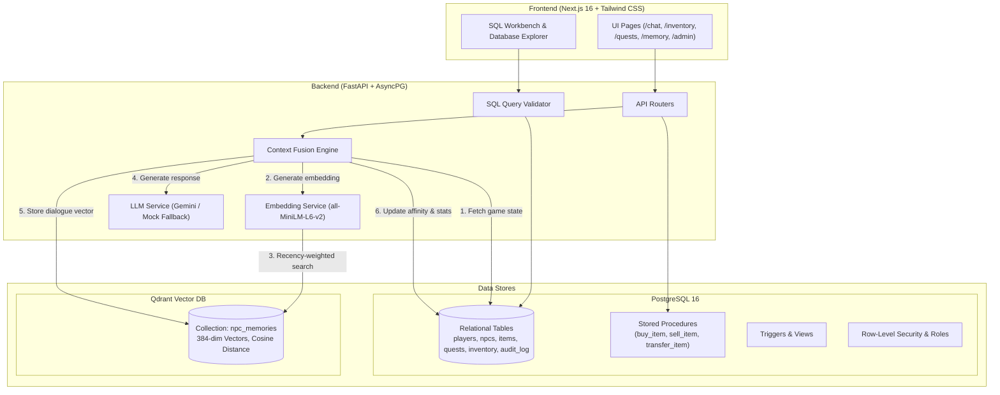
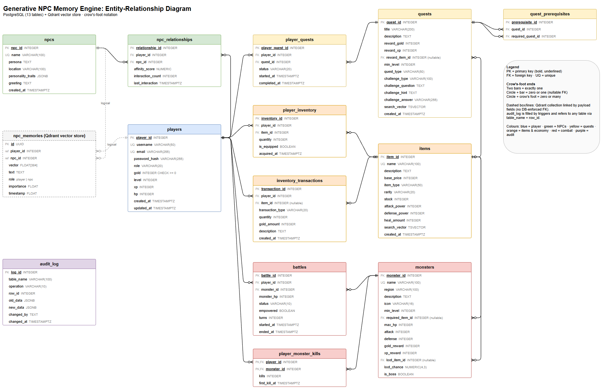
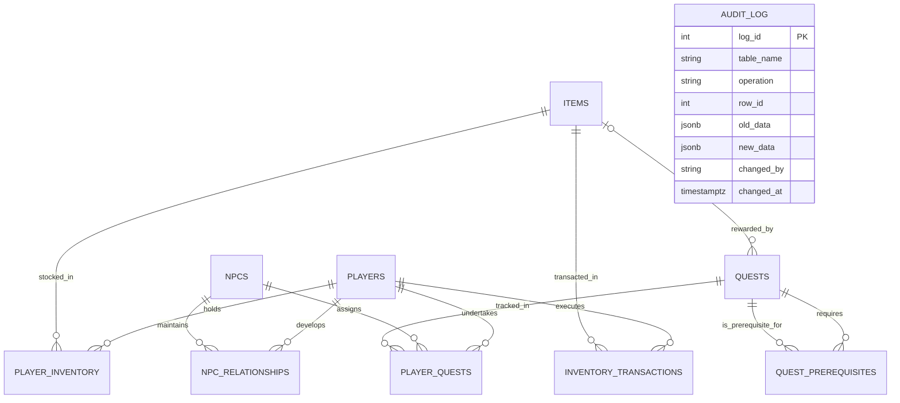

# Generative NPC Memory Engine

A hybrid database architecture combining **PostgreSQL** and **Qdrant** to power RPG non-player characters with persistent semantic memory and transactional game state.

Instead of relying purely on an LLM with a temporary context window, this engine decouples persistent game state from memory retrieval:
- **PostgreSQL** manages transactional state: player inventory, quest dependency graphs (DAGs), currency, item trading via pessimistic locking, audit logs, and row-level security.
- **Qdrant** indexes 384-dimensional dense conversation embeddings, retrieving relevant past interactions using cosine similarity combined with a recency-decay scoring function.

When a player speaks to an NPC, the engine gathers the player's relational state (affinity, quests, inventory), fetches relevant conversation history from Qdrant, synthesizes a context-aware response via LLM (with fallback support), and commits updates atomically.

---

## Architecture Overview



---

## Database Design

### Entity-Relationship (ER) Diagram





> For the classic entity-relationship view, see the [Chen Notation ER Diagram](docs/ER_DIAGRAM_CHEN.png).

#### Cardinalities & Relationships
- **PLAYERS — PLAYER_INVENTORY (1 : N)**: A player can hold multiple inventory items; each record belongs to one player.
- **PLAYERS — PLAYER_QUESTS (1 : N)**: A player can track multiple quests simultaneously.
- **NPCS — NPC_RELATIONSHIPS (1 : N)**: An NPC maintains separate affinity scores per player.
- **ITEMS — PLAYER_INVENTORY (1 : N)**: An item can be held across multiple player inventories.
- **QUESTS — QUEST_PREREQUISITES (M : N recursive)**: Quests form a directed acyclic graph (DAG) where quests can require multiple prerequisites and unlock downstream quests.
- **PLAYERS — INVENTORY_TRANSACTIONS (1 : N)**: Append-only ledger recording every purchase, sale, and quest reward.

---

### Relational Model & Schema

The PostgreSQL relational model comprises 10 core tables designed in **Third Normal Form (3NF)**:

| Relation | Primary Key | Foreign Keys | Key Constraints |
|---|---|---|---|
| `players` | `player_id` | — | `UNIQUE(username)`, `UNIQUE(email)`, `gold >= 0`, `level > 0`, `xp >= 0` |
| `npcs` | `npc_id` | — | `UNIQUE(name)`, `personality_traits` (JSONB) |
| `items` | `item_id` | — | `UNIQUE(name)`, `base_price > 0`, `stock >= -1`, Full-Text Search (GIN `search_vector`) |
| `quests` | `quest_id` | `reward_item_id -> items(item_id)` | `reward_gold >= 0`, `min_level > 0`, Full-Text Search (GIN `search_vector`) |
| `player_inventory` | `inventory_id` | `player_id -> players(player_id)`, `item_id -> items(item_id)` | `UNIQUE(player_id, item_id)`, `quantity >= 0` |
| `player_quests` | `player_quest_id` | `player_id -> players(player_id)`, `quest_id -> quests(quest_id)` | `UNIQUE(player_id, quest_id)`, `status IN ('available', 'active', 'completed', 'failed')` |
| `quest_prerequisites` | `prerequisite_id` | `quest_id -> quests(quest_id)`, `required_quest_id -> quests(quest_id)` | `UNIQUE(quest_id, required_quest_id)`, `CHECK (quest_id <> required_quest_id)` |
| `inventory_transactions` | `transaction_id` | `player_id -> players(player_id)`, `item_id -> items(item_id)` | `quantity > 0`, `transaction_type IN ('buy', 'sell', 'quest_reward', ...)` |
| `npc_relationships` | `relationship_id` | `player_id -> players(player_id)`, `npc_id -> npcs(npc_id)` | `UNIQUE(player_id, npc_id)`, `affinity_score BETWEEN -100.00 AND 100.00` |
| `audit_log` | `log_id` | — | `operation IN ('INSERT', 'UPDATE', 'DELETE')`, `old_data` (JSONB), `new_data` (JSONB) |

#### Referential Integrity & Cascade Rules
- **Account Cleanup (`ON DELETE CASCADE`)**: Deleting a player automatically cascades to `player_inventory`, `player_quests`, `inventory_transactions`, and `npc_relationships`.
- **Integrity Protection (`ON DELETE RESTRICT`)**: Items referenced in active inventories or quest prerequisites cannot be accidentally deleted.
- **Graceful Nullification (`ON DELETE SET NULL`)**: Removing an item clears the quest bonus item (`reward_item_id`) without invalidating quest progression.

#### Normalization (3NF)
- **1NF**: All columns contain atomic, scalar values (with structured `JSONB` for flexible personality traits). Every table has an explicit primary key (`GENERATED ALWAYS AS IDENTITY`).
- **2NF**: In composite-key relations (`player_inventory`, `player_quests`, `npc_relationships`), all non-key attributes (`quantity`, `status`, `affinity_score`) depend strictly on the whole candidate key, eliminating partial dependencies.
- **3NF**: Zero transitive dependencies exist. For example, item prices and descriptions are stored only in `items`, never duplicated in `player_inventory` or `inventory_transactions`.

---

## Features

### Dialogue & Memory Pipeline
- **Hybrid Context Assembly**: Combines structured database state (gold, active quests, relationship affinity) with unstructured vector memories.
- **Recency Decay Scoring**: Weights semantic similarity against elapsed time so NPCs prioritize recent events while still recalling critical past dialogue.
- **Tenant Isolation**: Memory queries are strictly filtered by player and NPC IDs to prevent cross-character memory leakage.
- **Resilient Fallback**: If the vector database is unreachable, the chat pipeline falls back gracefully to relational context without crashing.

### Relational Engine (PostgreSQL)
- **ACID Transactions & Row Locking**: Stored procedures (`buy_item`, `sell_item`, `transfer_item`) use `SELECT ... FOR UPDATE` to prevent race conditions and double-spending during trades.
- **Quest Dependency Graph**: Recursive Common Table Expressions (CTEs) validate prerequisite quest DAGs before a player can accept a new quest.
- **Integrity Constraints**: Database-level `CHECK` constraints enforce valid bounds (`gold >= 0`, `quantity >= 0`, `level > 0`).
- **Audit Logging & Triggers**: Automated database triggers log inventory mutations to an audit ledger and grant rewards upon quest completion.
- **Row-Level Security (RLS)**: Enforces database-level isolation between player sessions and administrative roles (`app_player` vs. `app_admin`).

### Built-in SQL Workbench & Analyzer
Accessible via the Admin portal (`/admin` -> SQL Console tab):
- **Query Editor**: Execute queries against the live database with syntax checking, execution timing, and row count metrics.
- **Execution Safeguards**:
  - *Read-Only Mode*: Wraps queries in `SET TRANSACTION READ ONLY` to prevent accidental mutations.
  - *DML Preview Mode*: Runs `INSERT`, `UPDATE`, and `DELETE` queries inside an isolated transaction and automatically rolls them back, letting you inspect affected rows safely.
  - *Explicit Commit Mode*: Requires confirmation before committing changes permanently.
- **Schema Explorer**: Inspect live table structures, columns, data types, primary keys, and foreign key relationships.
- **Query Plan Analyzer**: Runs `EXPLAIN (ANALYZE, BUFFERS)` to inspect optimizer costs, buffer hits, and execution tree nodes.
- **CSV Export**: Export query results directly to CSV.

---

## Getting Started

### Option 1: Docker Compose (Recommended)

Runs all services (PostgreSQL, Qdrant, FastAPI backend, and Next.js frontend):

```bash
git clone https://github.com/mat-7697/Generative-Memory-NPC-Engine.git
cd Generative-Memory-NPC-Engine

docker compose up --build
```

Services will be available at:
- **Frontend**: [http://localhost:3000](http://localhost:3000)
- **Backend API Docs**: [http://localhost:8000/docs](http://localhost:8000/docs)
- **Health Check**: [http://localhost:8000/api/health](http://localhost:8000/api/health)
- **Qdrant Dashboard**: [http://localhost:6333/dashboard](http://localhost:6333/dashboard)

---

### Option 2: Local Development

#### Prerequisites
- PostgreSQL 15+ (port 5432)
- Qdrant (port 6333)
- Python 3.10+
- Node.js 18+ and npm

#### 1. Start Databases
```bash
docker compose up -d postgres qdrant
```

#### 2. Initialize Qdrant Collection
```bash
python db/qdrant_setup.py
```

#### 3. Backend Setup
```bash
cd backend
python -m venv .venv

# Windows:
.venv\Scripts\activate
# Linux/macOS:
source .venv/bin/activate

pip install -r requirements.txt
uvicorn app.main:app --reload --port 8000
```

#### 4. Frontend Setup
```bash
cd frontend
npm install
npm run dev
```

Open [http://localhost:3000](http://localhost:3000) in your browser.

---

## Seed Accounts

| Username | Password | Role | Description |
|----------|----------|------|-------------|
| `admin` | `admin123` | Administrator | Full access to the SQL Workbench, schema explorer, audit logs, and management tools. |
| `hero` | `hero123` | Player (Warrior) | Level 4 warrior with 350 gold, active quests, and inventory items. |
| `mage` | `mage123` | Player (Mage) | Level 6 mage with 780 gold, used for testing item transfers and dialogue history. |

---

## Testing

Backend test suite covering constraints, stored procedures, triggers, recursive CTEs, and query parsing:

```bash
cd backend
pytest tests/ -v
```

---

## Documentation

Detailed technical documents are available in the [`docs/`](docs/) directory:

- [System Architecture](docs/ARCHITECTURE.md)
- [Database Schema & Constraints](docs/SCHEMA.md)
- [Entity-Relationship Diagram](docs/ER_DIAGRAM.md)
- [Data Dictionary](docs/DATA_DICTIONARY.md)
- [Relational vs. Vector Storage Rationale](docs/TECH_JUSTIFICATION.md)
- [Example Queries & Demonstrations](db/demo_queries.sql)
