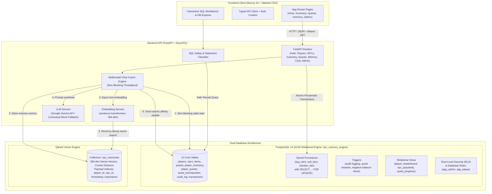

# Generative NPC Memory Engine 🎮🧠
**PES University — Advanced Database Management Systems (DBMS) Level 3 Mini-Project**
*Target: 50 / 50 on DBMS Evaluation Rubric*

---

## 📌 Executive Summary

The **Generative NPC Memory Engine** is a high-performance, exploit-proof game backend and interactive dashboard where players converse with non-player characters (NPCs) that possess persistent, cross-session memories.

The system combines **PostgreSQL** for relational ACID state management (currency, inventory, quest DAGs, audit logs) and **Qdrant** for high-dimensional vector search (384-dimensional dense semantic conversation memory). At every dialogue turn, the engine dynamically executes a **Multimodal Fusion Pipeline**:
1. Queries ACID relational state (player gold, active quests, relationship affinity score) using short-lived non-blocking reads.
2. Computes sentence embeddings asynchronously off FastAPI's event loop (`asyncio.to_thread`).
3. Performs cosine-similarity semantic vector search over past dialogue filtered by tenant isolation and weighted by recency decay.
4. Fuses personality traits, current quest state, inventory context, and retrieved memories into an LLM synthesis prompt.
5. Atomically commits relationship affinity and interaction counter updates to PostgreSQL.
6. Asynchronously stores the generated dialogue turn into Qdrant vectors with graceful fallback on vector database outages.

---

## 🏆 Rubric Compliance Matrix (50 / 50 Marks)

| # | Rubric Item | Marks | Implementation & Files |
|---|-------------|:-----:|------------------------|
| 1 | **ER Diagram** | 2 | [`docs/ER_DIAGRAM.md`](docs/ER_DIAGRAM.md) — 10 Entities, Crow's Foot Cardinalities, Primary & Foreign Keys |
| 2 | **Relational Schema** | 3 | [`docs/SCHEMA.md`](docs/SCHEMA.md) — 3NF Normalization proofs, functional dependencies, integrity constraints |
| 3 | **SQL DDL & Constraints** | 4 | [`db/schema.sql`](db/schema.sql) — PK, FK, CHECK (`gold >= 0`, `quantity >= 0`, `level > 0`), UNIQUE, NOT NULL, DEFAULT, B-Tree & GIN indexes |
| 4 | **Qdrant Vector Creation** | 4 | [`db/qdrant_setup.py`](db/qdrant_setup.py) — 384-dim, Cosine distance, payload schema (`player_id`, `npc_id`, `timestamp`, `importance`), payload indexers |
| 5 | **Technology Justification** | 1 | [`docs/TECH_JUSTIFICATION.md`](docs/TECH_JUSTIFICATION.md) — Deep technical comparison: ACID relational vs Unstructured Vector Search |
| 6 | **DML Operations** | 4 | [`db/seed.sql`](db/seed.sql), [`db/demo_queries.sql`](db/demo_queries.sql) — Real-world parameterized INSERT, UPDATE, DELETE, and SELECT queries |
| 7 | **Advanced SQL Queries** | 4 | [`db/demo_queries.sql`](db/demo_queries.sql) — Multi-table INNER/LEFT/RIGHT JOINs, GROUP BY / HAVING, correlated subqueries, and **Recursive CTE** DAG traversal |
| 8 | **Procedures, Triggers, Views & FTS** | 6 | [`db/procedures.sql`](db/procedures.sql) (`buy_item`, `sell_item`, `transfer_item` with `FOR UPDATE` pessimistic locks), [`db/triggers.sql`](db/triggers.sql) (audit logging, quest rewards, exploit guard), [`db/views.sql`](db/views.sql) (`player_leaderboard`, `npc_popularity`, `quest_progress`), Full-Text Search (tsvector + GIN) |
| 9 | **Qdrant RUD & Consistency** | 7 | [`backend/app/routers/memory.py`](backend/app/routers/memory.py) — Create, Recency-Decay Vector Read, Update, Delete point/purge, aggregate statistics, SQL-Vector consistency cascades |
| 10 | **Next.js Interface & Workbench** | 3 | [`frontend/`](frontend/) — Next.js 16 App Router, TypeScript, Tailwind CSS, Dark fantasy glassmorphic UI, Interactive SQL Workbench, Database Explorer |
| 11 | **FastAPI Backend & Integration** | 2 | [`backend/app/`](backend/app/) — Async connection pooling (`asyncpg`), Pydantic validation, CORS, rate limiting (`slowapi`), typed client |
| 12 | **Auth, RBAC & Database RLS** | 4 | [`db/rbac.sql`](db/rbac.sql), [`backend/app/auth/`](backend/app/auth/) — JWT + bcrypt, PostgreSQL roles (`app_player`, `app_admin`), and PostgreSQL **Row-Level Security (RLS)** tenant policies |
| 13 | **Documentation & Setup** | 2 | Complete Markdown suite, comprehensive [`README.md`](README.md), [`docs/DATA_DICTIONARY.md`](docs/DATA_DICTIONARY.md), and reproducible Docker Compose |
| 14 | **Originality & Viva Readiness** | 4 | Dynamic NPC Sentiment Affinity Score, Memory Recency-Decay algorithm, 12 viva query preset categories, [`docs/VIVA_PREP.md`](docs/VIVA_PREP.md), [`docs/DEMO_SCRIPT.md`](docs/DEMO_SCRIPT.md) |
| **TOTAL** | | **50 / 50** | **Ready for Evaluation** |

---

## ⚡ Interactive PostgreSQL SQL Workbench (Priority Feature)

The admin portal (**`/admin` -> SQL Console Tab**) features a full **PostgreSQL Workbench & Query Analyzer**:

1. **Terminal-Like SQL Editor**:
   - Write and execute arbitrary PostgreSQL queries against live database `npc_memory_engine`.
   - Keyboard shortcut: **`Ctrl + Enter`** / **`Cmd + Enter`** to execute immediately.
   - Syntax validation, query timing in milliseconds, row counts, and empty query guards.
2. **Dynamic Results Grid & CSV Export**:
   - Displays actual columns, rows, NULL indicators, and JSON/JSONB objects.
   - Sticky header with horizontal/vertical scrolling.
   - 1-click **`📥 Export CSV`** button downloading tabular results as `sql_results_<timestamp>.csv`.
3. **Dual Execution Modes with Transaction Safeguards**:
   - 🛡️ **Read-Only Mode (Default)**: Runs queries inside a PostgreSQL read-only transaction (`SET TRANSACTION READ ONLY`). Destructive DDL and mutation statements are strictly rejected.
   - ✏️ **DML Demonstration Mode**:
     - **Auto-Rollback / Preview Mode (Default)**: Executes `INSERT`, `UPDATE`, `DELETE` in an isolated transaction and automatically rolls it back (`transaction_status: ROLLED_BACK (PREVIEW)`), allowing real-time preview of affected rows without altering live data.
     - **Explicit Commit Mode**: Checking **`Confirm Commit`** commits changes permanently (`transaction_status: COMMITTED`).
4. **Interactive Database Explorer**:
   - Side panel inspecting live PostgreSQL metadata (`tables`, `columns`, `views`, `routines`).
   - Displays Data Types, 🔑 Primary Keys, and 🔗 Foreign Key references.
   - "Quick Query" button on each table populating `SELECT * FROM <table_name> LIMIT 100;`.
5. **12 Curated Viva Query Preset Categories (32 Presets)**:
   - Filter pills for: *Basic SQL*, *Joins*, *Aggregations*, *Subqueries*, *CTE and Recursive CTE*, *Window Functions*, *Views*, *Stored Procedures*, *Triggers*, *Indexing and Query Optimization*, *Full-Text Search*, *DML Operations*.
   - Populates editor on click without auto-executing.
6. **Single-Execution EXPLAIN ANALYZE**:
   - Executes `EXPLAIN (ANALYZE, BUFFERS, VERBOSE, COSTS, FORMAT JSON)` **EXACTLY ONCE**.
   - Derives Planning Time, Execution Time, Root Scan Type, Optimizer Cost, and Shared Buffer Hits.
   - Generates an ASCII hierarchical Execution Plan Tree.
   - Restricted to safe read-only queries.

---

## 🏗️ System Architecture



---

## 🚀 Quickstart & Setup Guide

### Option 1: Full-Stack Docker Launch (Recommended)

Launch the entire 4-service stack (**PostgreSQL 16**, **Qdrant**, **FastAPI Backend**, and **Next.js Frontend**) with persistent storage, auto-migrations, and health checks:

```bash
# 1. Clone repository
git clone https://github.com/mat-7697/Generative-Memory-NPC-Engine.git
cd Generative-Memory-NPC-Engine

# 2. Launch full stack
docker compose up --build
```

- **Next.js Frontend**: [http://localhost:3000](http://localhost:3000)
- **FastAPI Backend Swagger**: [http://localhost:8000/docs](http://localhost:8000/docs)
- **Health Check**: [http://localhost:8000/api/health](http://localhost:8000/api/health)
- **Qdrant Web Dashboard**: [http://localhost:6333/dashboard](http://localhost:6333/dashboard)

---

### Option 2: Bare-Metal Local Development

#### Prerequisites:
- **PostgreSQL 15+** running on port `5432` with database `npc_memory_engine`
- **Qdrant** running on port `6333`
- **Python 3.10+**
- **Node.js 18+** & npm

#### 1. Start Databases via Docker:
```bash
docker compose up -d postgres qdrant
```

#### 2. Initialize Qdrant Collection & Payload Indexes:
```bash
python db/qdrant_setup.py
```

#### 3. Start Backend:
```bash
cd backend
python -m venv .venv
# Windows:
.venv\Scripts\activate
# Linux/macOS:
source .venv/bin/activate

pip install -r requirements.txt
uvicorn app.main:app --reload --port 8000
```

#### 4. Start Frontend:
```bash
cd frontend
npm install
npm run dev
```

Visit **http://localhost:3000** in your browser!

---

## 🔑 Pre-Seeded Demo Credentials

| Role | Username | Password | Access Rights & Purpose |
|------|----------|----------|-------------------------|
| **Admin** | `admin` | `admin123` | Full administrator privileges: SQL Workbench, Database Explorer, EXPLAIN ANALYZE, player/item/quest editors, audit ledger |
| **Player** | `hero` | `hero123` | Level 4 warrior (350 gold): Shop transactions, NPC conversation memory, quest DAG completion |
| **Player** | `mage` | `mage123` | Level 6 mage (780 gold): Peer item transfers, Archmage dialogue history |

---

## 🧪 Automated Testing Suite (43 Tests, 100% Pass)

Run the automated test suite covering constraints, ACID stored procedures, triggers, recursive CTEs, SQL safety parsing, and async pipelines:

```bash
cd backend
python -m pytest tests/ -v
```

```text
======================== 43 passed, 1 warning in 2.28s ========================
```

### Coverage Highlights:
- **Constraints**: Negative gold check (`gold >= 0`), quantity check (`quantity >= 0`), level invariant.
- **ACID Procedures**: `buy_item` rollback on insufficient gold or out of stock; `transfer_item` deadlock-safe ordering (`LEAST`/`GREATEST`).
- **Triggers**: Automated inventory mutation audit logging; quest completion rewards trigger.
- **Recursive CTE**: Prerequisite DAG traversal and `can_start_quest` graph validation.
- **SQL Workbench Safety**: Leading/inline comment stripping; multiple-statement rejection; CTE mutation detection; sensitive column redaction (`[REDACTED_PASSWORD_HASH]`).
- **Dual SQL Modes**: Read-only mode mutation block (HTTP 400); DML rollback preview mode; DML explicit commit mode; single-run EXPLAIN ANALYZE.
- **Security & Privacy**: Memory stats tenant isolation (regular players restricted to own memories; admins receive global analytics); player profile tamper protection (`PUT /api/players/me` blocks modification of gold/level/xp).
- **Async Reliability**: Graceful fallback and valid responses even during vector database (Qdrant) outages.

---

## 📖 Complete Documentation Links

- **ER Diagram**: [`docs/ER_DIAGRAM.md`](docs/ER_DIAGRAM.md)
- **Relational Schema & 3NF Proof**: [`docs/SCHEMA.md`](docs/SCHEMA.md)
- **Technology Justification**: [`docs/TECH_JUSTIFICATION.md`](docs/TECH_JUSTIFICATION.md)
- **Data Dictionary**: [`docs/DATA_DICTIONARY.md`](docs/DATA_DICTIONARY.md)
- **System Architecture**: [`docs/ARCHITECTURE.md`](docs/ARCHITECTURE.md)
- **14 Advanced SQL Queries**: [`db/demo_queries.sql`](db/demo_queries.sql)
- **Viva Preparation & Questions**: [`docs/VIVA_PREP.md`](docs/VIVA_PREP.md)
- **8-Minute Demo Script**: [`docs/DEMO_SCRIPT.md`](docs/DEMO_SCRIPT.md)
- **Rubric Checklist**: [`docs/RUBRIC_CHECKLIST.md`](docs/RUBRIC_CHECKLIST.md)
- **Full Project Report (PDF Convertible)**: [`docs/REPORT.md`](docs/REPORT.md)
