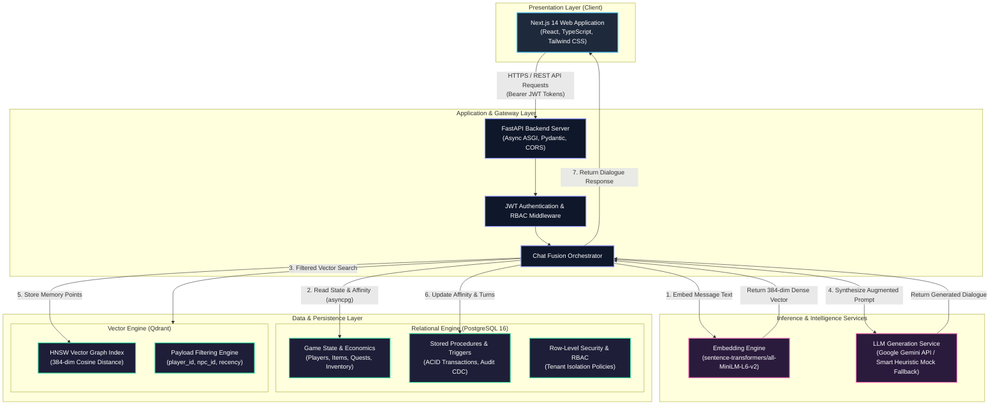
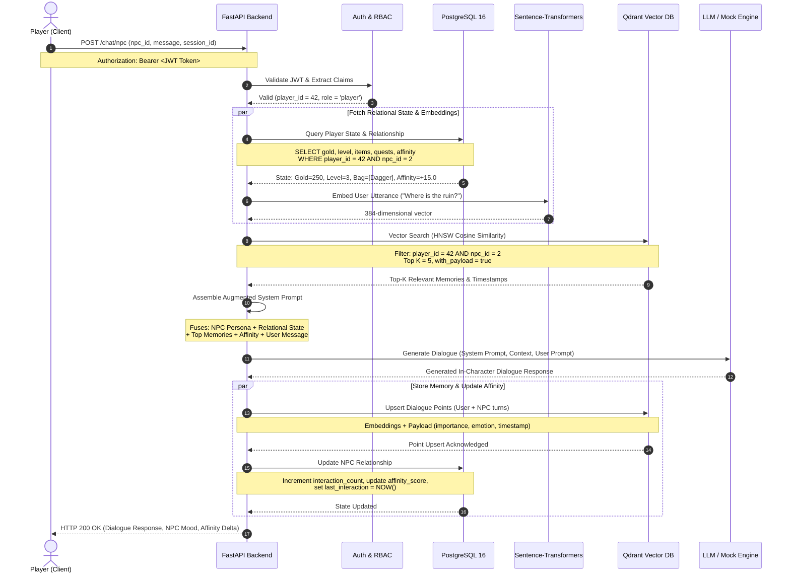
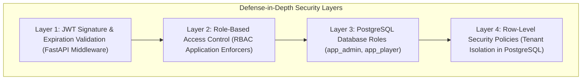

# System Architecture Specification

This document presents the complete system architecture for the **Generative NPC Memory Engine**, encompassing the full-stack infrastructure topology, context-fusion dialogue flow, multi-tenant security model, and polyglot database synchronization guarantees.

---

## 1. High-Level System Architecture

The Generative NPC Memory Engine follows a modern decoupled three-tier architecture:
1. **Presentation Layer (Frontend)**: Next.js 14 App Router, TypeScript, and Tailwind CSS.
2. **Application & Orchestration Layer (Backend)**: Python FastAPI with asynchronous connection pooling via `asyncpg`, handling business workflows, authentication, and chat context fusion.
3. **Data Layer (Polyglot Persistence)**:
   - **PostgreSQL 16**: Primary relational database for transactional game state, stored procedures, triggers, and Row-Level Security.
   - **Qdrant Vector DB**: Vector similarity engine indexing 384-dimensional dialogue memories using HNSW graph algorithms.
   - **Local / Cloud AI Inference**: `sentence-transformers` embedding generation and Google Gemini / Local Mock LLM dialogue synthesis.



---

## 2. Chat Fusion Flow Sequence

The cornerstone feature of the Generative NPC Memory Engine is the **Context Fusion Pipeline**. When a player utters a message to an NPC, the system fuses **episodic memory** (from Qdrant) with **ground-truth relational game state** (from PostgreSQL) to generate contextualized responses that acknowledge past conversations, held inventory, completed quests, and relationship affinity.



---

## 3. Security Architecture & Authorization

Security is enforced hierarchically across the network gateway, application middleware, and native database engine.



### 3.1 Token-Based Authentication (JWT)
- **Hashing**: Passwords are cryptographically salted and hashed using **Bcrypt** ($2^{12}$ rounds). Plaintext passwords are never persisted or logged.
- **Tokens**: Access tokens are signed using `HMAC-SHA256` (HS256) containing claims:
  - `sub`: Canonical username
  - `player_id`: Integer primary key identifier
  - `role`: Role string (`'player'` or `'admin'`)
  - `exp`: Short-lived expiration (e.g., 60 minutes)

### 3.2 Role-Based Access Control (RBAC)
Two primary authorization tiers are enforced:
- **`app_player`**: Can only view their own inventory, embark on quests, trade with merchants via stored procedures, and chat with NPCs.
- **`app_admin`**: Can access administrative endpoints (`/admin/*`), create or modify NPCs, grant items, inspect global audit logs, and trigger maintenance procedures.

### 3.3 Database-Level Row-Level Security (RLS)
Unlike naive applications that rely solely on application-level `WHERE player_id = X` clauses, the engine activates native **PostgreSQL Row-Level Security**:
```sql
ALTER TABLE player_inventory ENABLE ROW LEVEL SECURITY;
ALTER TABLE player_quests ENABLE ROW LEVEL SECURITY;
ALTER TABLE inventory_transactions ENABLE ROW LEVEL SECURITY;

CREATE POLICY player_inventory_isolation_policy ON player_inventory
    FOR ALL
    TO app_player
    USING (player_id = NULLIF(current_setting('app.current_player_id', true), '')::INTEGER);
```
Before executing tenant queries within an application connection, FastAPI issues:
```sql
SET LOCAL app.current_player_id = '42';
```
Even if an SQL injection vulnerability were introduced in the application layer, PostgreSQL's kernel prevents the query from seeing or modifying any inventory rows belonging to other players.

---

## 4. Polyglot Database Consistency

A critical challenge in dual-database architectures is maintaining synchronization between the relational engine (PostgreSQL) and the vector engine (Qdrant).

### 4.1 Transactional Boundaries
- **Strict Precedence**: State-changing game events (e.g., purchasing an item, claiming quest rewards) execute **exclusively** within PostgreSQL ACID transactions before vector memory is modified.
- **Idempotency**: Qdrant point IDs are deterministically generated UUIDs derived from session hashes or consecutive message IDs. Retrying a failed chat turn will overwrite the identical point ID rather than creating duplicate memory vectors.

### 4.2 Cascading Deletions & Memory Cleanup
When a player or NPC record is deleted in PostgreSQL (`ON DELETE CASCADE`), associated vector memories in Qdrant must not become orphaned.
- **Cleanup Handlers**: An administrative background task or API event handler executes Qdrant delete operations filtering by payload:
```python
await qdrant_client.delete(
    collection_name="npc_memories",
    points_selector=models.FilterSelector(
        filter=models.Filter(
            must=[models.FieldCondition(key="player_id", match=models.MatchValue(value=deleted_player_id))]
        )
    ),
)
```
- **Audit Verification**: The PostgreSQL `audit_log` records all deletions. A reconciliation worker periodically verifies that Qdrant contains zero points referencing player IDs flagged as deleted in `audit_log`.
