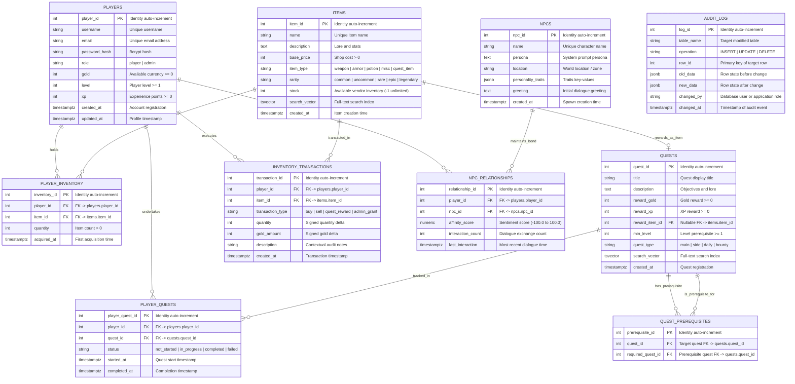

# Entity-Relationship (ER) Diagram

This document presents the complete Entity-Relationship model for the **Generative NPC Memory Engine** database. The relational database schema is implemented in PostgreSQL 16+ and comprises 10 core tables designed in Third Normal Form (3NF), supporting ACID-compliant transactional gameplay, quest dependency graphs, audit trails, and multi-tenant player isolation.

---

## 1. Complete Mermaid ER Diagram

---

## 2. Entity Descriptions & Primary Keys

| # | Entity Name | Primary Key | Description & Domain Role |
|---|---|---|---|
| 1 | `players` | `player_id` | Core user identity, credentials, progression (level/XP), and liquid currency (gold). Protected by strict non-negative check constraints. |
| 2 | `npcs` | `npc_id` | Non-player characters with distinctive personas, personality traits stored in JSONB, world locations, and dialogue prompts. |
| 3 | `items` | `item_id` | Master catalog of gear, consumables, and quest items, including base prices, rarity tiers, and GIN-indexed tsvectors for full-text search. |
| 4 | `quests` | `quest_id` | Objectives and missions offering XP, gold, and optional item rewards (`reward_item_id`). Supports full-text search. |
| 5 | `player_inventory` | `inventory_id` | Junction table associating players with items. Enforces `UNIQUE(player_id, item_id)` and `quantity > 0`. |
| 6 | `player_quests` | `player_quest_id` | State tracking for quest progression (`in_progress`, `completed`, `failed`), enforcing `UNIQUE(player_id, quest_id)`. |
| 7 | `quest_prerequisites` | `prerequisite_id` | Self-referential Directed Acyclic Graph (DAG) over `quests` defining completion prerequisites, traversed via recursive CTEs. |
| 8 | `inventory_transactions`| `transaction_id` | Immutable double-entry financial and item movement ledger tracking purchases, sales, and rewards. |
| 9 | `npc_relationships` | `relationship_id` | Dynamic player-NPC social dynamics, tracking emotional affinity (`-100.0` to `+100.0`) and total interactions. |
| 10 | `audit_log` | `log_id` | Autonomous change data capture (CDC) repository populated by PostgreSQL triggers recording before-and-after JSONB diffs. |

---

## 3. Relationships & Cardinalities Detailed

1. **`players` to `player_inventory` (1 : 0..*)**
   - **Cardinality**: One player can hold zero, one, or many inventory items (`1--o{`).
   - **Foreign Key**: `player_inventory.player_id` references `players.player_id` with `ON DELETE CASCADE`.
   - **Integrity**: Enforced by composite uniqueness `UNIQUE (player_id, item_id)`.

2. **`items` to `player_inventory` (1 : 0..*)**
   - **Cardinality**: One catalog item can be possessed by zero or multiple players (`1--o{`).
   - **Foreign Key**: `player_inventory.item_id` references `items.item_id` with `ON DELETE RESTRICT` (items cannot be dropped if held).

3. **`players` to `player_quests` (1 : 0..*)**
   - **Cardinality**: One player may accept zero or multiple quests (`1--o{`).
   - **Foreign Key**: `player_quests.player_id` references `players.player_id` with `ON DELETE CASCADE`.
   - **Integrity**: Enforced by composite uniqueness `UNIQUE (player_id, quest_id)`.

4. **`quests` to `player_quests` (1 : 0..*)**
   - **Cardinality**: One quest may be undertaken by zero or multiple players (`1--o{`).
   - **Foreign Key**: `player_quests.quest_id` references `quests.quest_id` with `ON DELETE CASCADE`.

5. **`quests` to `quest_prerequisites` [Target Quest] (1 : 0..*)**
   - **Cardinality**: One quest can have zero or multiple prerequisite quests (`1--o{`).
   - **Foreign Key**: `quest_prerequisites.quest_id` references `quests.quest_id` with `ON DELETE CASCADE`.

6. **`quests` to `quest_prerequisites` [Required Quest] (1 : 0..*)**
   - **Cardinality**: One quest can act as a prerequisite for zero or multiple other quests (`1--o{`).
   - **Foreign Key**: `quest_prerequisites.required_quest_id` references `quests.quest_id` with `ON DELETE RESTRICT`.

7. **`players` to `inventory_transactions` (1 : 0..*)**
   - **Cardinality**: One player can have zero or multiple transaction records (`1--o{`).
   - **Foreign Key**: `inventory_transactions.player_id` references `players.player_id` with `ON DELETE CASCADE`.

8. **`items` to `inventory_transactions` (1 : 0..*)**
   - **Cardinality**: One item can appear in zero or multiple transaction entries (`1--o{`).
   - **Foreign Key**: `inventory_transactions.item_id` references `items.item_id` with `ON DELETE RESTRICT`.

9. **`players` to `npc_relationships` (1 : 0..*)**
   - **Cardinality**: One player can interact with zero or multiple distinct NPCs (`1--o{`).
   - **Foreign Key**: `npc_relationships.player_id` references `players.player_id` with `ON DELETE CASCADE`.
   - **Integrity**: Enforced by `UNIQUE (player_id, npc_id)`.

10. **`npcs` to `npc_relationships` (1 : 0..*)**
    - **Cardinality**: One NPC maintains social relationships with zero or many players (`1--o{`).
    - **Foreign Key**: `npc_relationships.npc_id` references `npcs.npc_id` with `ON DELETE CASCADE`.

11. **`items` to `quests` [Reward Item] (1 : 0..1)**
    - **Cardinality**: An item can optionally be assigned as a reward for quests; a quest rewards zero or one item (`1--o|`).
    - **Foreign Key**: `quests.reward_item_id` references `items.item_id` with `ON DELETE SET NULL`.

12. **`audit_log` (Autonomous)**
    - **Design**: Does not maintain hard foreign key constraints to prevent audit record loss if entities are expunged, recording `table_name` and `row_id` alongside full JSONB state payloads (`old_data`, `new_data`).

---

## 4. Vector Memory Integration (Qdrant)

While PostgreSQL manages the relational game state above, high-dimensional conversation memory is stored in **Qdrant**:
- **Collection**: `npc_memories`
- **Vector Space**: 384-dimensional dense vectors (`sentence-transformers/all-MiniLM-L6-v2`) with Cosine Distance.
- **Relational Linkage**: Every vector payload stores `player_id` and `npc_id` matching `players.player_id` and `npcs.npc_id`.
- **Payload Indexing**: Filtered search queries combine exact relational IDs (`player_id = X AND npc_id = Y`) with semantic nearest-neighbor memory retrieval.
