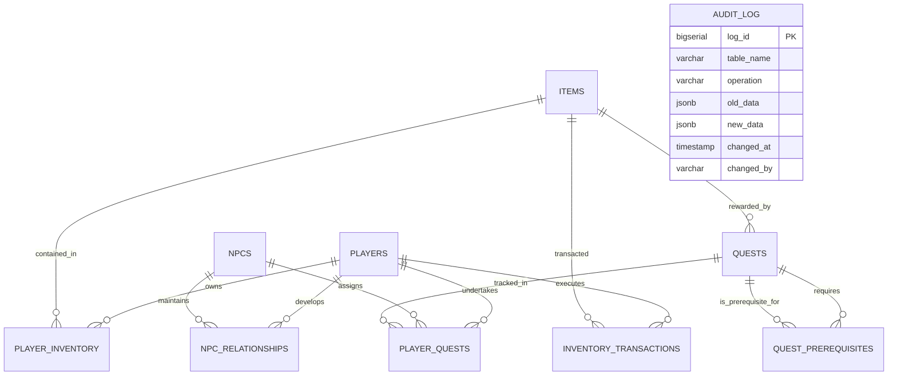

# PROJECT REPORT
## GENERATIVE NPC MEMORY ENGINE
### Multi-Tier Exploitation-Proof Game Engine Uniting ACID PostgreSQL and Qdrant Semantic Memory

**Institution:** PES University  
**Course:** Advanced Database Management Systems (DBMS) — Level 3 Mini-Project  
**Target Grade:** 50 / 50 on DBMS Evaluation Rubric  
**Project Repository:** https://github.com/mat-7697/Generative-Memory-NPC-Engine  

---

## 📋 TEAM CONTRIBUTION MATRIX

| Member Name | Role | Primary Responsibilities | Core Files Authored |
|:---|:---|:---|:---|
| **Person A** | Database & Vector Specialist | Relational Schema Design, Normalization (3NF), Advanced SQL (Procedures with Pessimistic Row Locks, Triggers, Recursive CTEs, Views, tsvector Full-Text Search), PostgreSQL RBAC (`app_admin`, `app_player`) and Row-Level Security (RLS) policies, Qdrant collection setup & payload indexers, Concurrency Race Condition testing. | `db/schema.sql`, `db/procedures.sql`, `db/triggers.sql`, `db/views.sql`, `db/rbac.sql`, `db/seed.sql`, `db/demo_queries.sql`, `db/qdrant_setup.py`, `backend/app/services/embedding.py`, `backend/tests/test_advanced_dbms.py` |
| **Person B** | Full-Stack & API Security Specialist | FastAPI Backend Architecture, Connection Pooling (`asyncpg`), Pydantic Data Models, JWT Authentication & Bcrypt Password Hashing, Multimodal Chat Fusion Pipeline (State retrieval + Vector Top-K + Prompt Synthesis + Sentiment Heuristic), Next.js 16 App Router Frontend, Dark Fantasy UI & CSS design system, Typed API Client. | `backend/app/main.py`, `backend/app/routers/` (Auth, Players, NPCs, Inventory, Quests, Memory, Chat, Admin), `backend/app/services/chat_fusion.py`, `backend/app/services/llm.py`, `frontend/src/` (8 interactive application pages & dashboard) |

---

## 1. PROBLEM STATEMENT & OBJECTIVES

### 1.1 Problem Statement
Modern generative AI video games face two major architectural dilemmas:
1. **The Context Amnesia Problem:** Non-Player Characters (NPCs) driven by Large Language Models lack long-term conversational memory across player sessions. Traditional LLM context windows cannot store thousands of dialogue turns without exponential cost and latency degradation.
2. **The Relational Exploitation Problem:** Pure LLM or unstructured document databases are incapable of enforcing ACID transactional invariants. In multiplayer game economies, inventory duplication, gold exploits, and unverified quest progressions occur when game mechanics are handled without strict database-level pessimistic locking and relational integrity constraints.

### 1.2 Project Objectives
- **Zero-Exploit ACID Relational Engine:** Model a 3NF relational database in PostgreSQL enforcing strict database-level validation (CHECK constraints, foreign keys with cascade policies, stored procedures with pessimistic row locks, and automated audit triggers).
- **Generative Vector Memory:** Implement a high-performance vector database (Qdrant) indexing 384-dimensional dense semantic embeddings with recency-decay scoring to maintain cross-session NPC memories.
- **Multimodal State Fusion:** Implement an API pipeline that loads relational game state, performs filtered vector search, prompts an LLM with structured state context, and atomically updates NPC relationship metrics.
- **Dual-Layer RBAC & Row-Level Security:** Enforce role-based access control both at the application layer (JWT, FastAPI dependencies) and at the database engine layer (PostgreSQL roles `app_admin` / `app_player`, GRANT/REVOKE privileges, and tenant-isolating Row-Level Security).
- **Interactive Full-Stack Web Application:** Deliver an intuitive, dark-fantasy themed Next.js 16 interface showcasing real-time chat, inventory transactions, quest DAG prerequisite trees, vector memory management, and administrative control.

---

## 2. DATABASE CHOICE & TECHNOLOGY JUSTIFICATION

| Feature / Metric | PostgreSQL (Relational Engine) | Qdrant (Vector Engine) | Architectural Justification |
|:---|:---|:---|:---|
| **Data Handled** | Players, NPCs, Inventory, Items, Quests, Prerequisites, Audit Logs, Ledgers. | Unstructured dialogue turns, player statements, NPC utterances, observations. | Relational state requires rigid schemas and entity associations; dialogue is unstructured natural language. |
| **Integrity & ACID** | Full ACID (Atomicity, Consistency, Isolation, Durability) guarantees. | Eventual consistency; optimized for high-throughput approximate nearest neighbor (ANN) search. | Financial game economies (gold, stock) cannot tolerate duplicate spending; conversation memory tolerates slight vector latency. |
| **Concurrency Control** | Pessimistic Row Locking (`SELECT ... FOR UPDATE`), transaction rollbacks. | Optimistic concurrent point upserts. | Multiple concurrent purchase requests must queue atomically on item stock and player gold rows. |
| **Search Paradigm** | Exact index lookups (B-Tree), relational joins, recursive DAG traversals, tsvector lexical search. | High-dimensional dense vector distance (Cosine Similarity metric with HNSW index). | Relational queries cannot compute semantic similarity between "I need a blade" and "Here is an iron sword". |
| **Data Decay / Scoring** | Temporal timestamp comparisons. | Hybrid dynamic scoring (`Score = 0.70 * Similarity + 0.30 * RecencyDecay`). | NPCs should remember semantically relevant memories, prioritizing recent events over ancient ones. |

---

## 3. ENTITY-RELATIONSHIP (ER) DIAGRAM & CARDINALITIES



### 3.1 Entity Cardinality & Multiplicity Matrix
1. **PLAYERS to PLAYER_INVENTORY:** One-to-Many (`1:N`). A player owns zero or many inventory item rows; each inventory row belongs strictly to one player.
2. **PLAYERS to PLAYER_QUESTS:** One-to-Many (`1:N`). A player can undertake multiple quests; each tracking record links one player to one quest.
3. **NPCS to NPC_RELATIONSHIPS:** One-to-Many (`1:N`). An NPC maintains distinct affinity scores with multiple players.
4. **QUESTS to QUEST_PREREQUISITES:** Recursive Many-to-Many (`M:N`). A quest can require multiple prerequisite quests, and a single quest can be a prerequisite for multiple downstream quests (directed acyclic graph).

---

## 4. RELATIONAL SCHEMA & 3NF NORMALIZATION

### 4.1 3NF Normalization Proof
- **First Normal Form (1NF):** All attributes contain atomic, scalar values (except personality traits stored as structured JSONB documents). Every table possesses an explicit primary key (`player_id`, `item_id`, etc.), and no repeating groups exist.
- **Second Normal Form (2NF):** Every non-key attribute is fully functionally dependent on the entire primary key. In composite-key tables like `player_inventory(player_id, item_id)` and `player_quests(player_id, quest_id)`, attributes such as `quantity` and `status` depend on the composite pair, not a partial subset.
- **Third Normal Form (3NF):** No transitive functional dependencies exist ($X \to Y$ where $Y \to Z$ and $X$ is not a superkey). For instance, quest rewards (`reward_gold`, `reward_item_id`) depend solely on `quest_id`, rather than being stored redundantly in `player_quests`.

---

## 5. DATA DICTIONARY

### Table: `players`
| Column Name | Data Type | Constraints | Description |
|:---|:---|:---|:---|
| `player_id` | `SERIAL` | `PRIMARY KEY` | Unique internal surrogate identifier. |
| `username` | `VARCHAR(50)` | `NOT NULL, UNIQUE` | Unique player login handle. |
| `email` | `VARCHAR(255)` | `NOT NULL, UNIQUE` | Unique contact and verification email. |
| `password_hash` | `VARCHAR(255)` | `NOT NULL` | Bcrypt cryptographic password digest. |
| `role` | `VARCHAR(20)` | `NOT NULL, DEFAULT 'player', CHECK (role IN ('player', 'admin'))` | Security authorization role. |
| `gold` | `INTEGER` | `NOT NULL, DEFAULT 100, CHECK (gold >= 0)` | Currency balance protected against negative overdrafts. |
| `level` | `INTEGER` | `NOT NULL, DEFAULT 1, CHECK (level >= 1)` | Character progression tier. |
| `xp` | `INTEGER` | `NOT NULL, DEFAULT 0, CHECK (xp >= 0)` | Experience points. |
| `created_at` | `TIMESTAMPTZ` | `NOT NULL, DEFAULT CURRENT_TIMESTAMP` | Account creation timestamp. |

### Table: `items`
| Column Name | Data Type | Constraints | Description |
|:---|:---|:---|:---|
| `item_id` | `SERIAL` | `PRIMARY KEY` | Unique item identifier. |
| `name` | `VARCHAR(100)` | `NOT NULL, UNIQUE` | Unique name of game item. |
| `description` | `TEXT` | `NULL` | Item lore and functional summary. |
| `base_price` | `INTEGER` | `NOT NULL, CHECK (base_price > 0)` | Base merchant monetary value. |
| `item_type` | `VARCHAR(30)` | `NOT NULL, CHECK (item_type IN ('weapon', 'armor', 'potion', 'misc', 'quest_item'))` | Category classifier. |
| `rarity` | `VARCHAR(20)` | `NOT NULL, DEFAULT 'common', CHECK (rarity IN ('common', 'uncommon', 'rare', 'epic', 'legendary'))` | Rarity tier indicator. |
| `stock` | `INTEGER` | `NOT NULL, DEFAULT -1, CHECK (stock >= -1)` | Merchant stock (-1 represents unlimited stock). |
| `search_vector` | `TSVECTOR` | `GENERATED ALWAYS AS (to_tsvector('english', coalesce(name, '') \|\| ' ' \|\| coalesce(description, ''))) STORED` | Full-Text search vector indexed via GIN. |

*(Complete dictionaries for all 9 tables are detailed in [`docs/DATA_DICTIONARY.md`](DATA_DICTIONARY.md))*

---

## 6. ADVANCED DATABASE CONCEPTS IMPLEMENTED

### 6.1 Recursive Common Table Expression (CTE) for Quest DAGs
To prevent players from undertaking advanced quests without fulfilling multi-level prerequisites, the database features a recursive CTE function:
```sql
CREATE OR REPLACE FUNCTION get_prerequisite_chain(p_quest_id INTEGER)
RETURNS TABLE(
    depth INTEGER,
    quest_id INTEGER,
    title VARCHAR,
    prerequisite_quest_id INTEGER,
    prerequisite_title VARCHAR
) LANGUAGE sql STABLE AS $$
WITH RECURSIVE prereq_tree AS (
    -- Anchor member: immediate dependencies
    SELECT 
        1 AS depth,
        qp.quest_id,
        q.title,
        qp.prerequisite_quest_id,
        pq.title AS prerequisite_title
    FROM quest_prerequisites qp
    JOIN quests q ON q.quest_id = qp.quest_id
    JOIN quests pq ON pq.quest_id = qp.prerequisite_quest_id
    WHERE qp.quest_id = p_quest_id

    UNION ALL

    -- Recursive member: traverse upstream dependencies
    SELECT 
        pt.depth + 1,
        qp.quest_id,
        q.title,
        qp.prerequisite_quest_id,
        pq.title AS prerequisite_title
    FROM quest_prerequisites qp
    JOIN quests q ON q.quest_id = qp.quest_id
    JOIN quests pq ON pq.quest_id = qp.prerequisite_quest_id
    JOIN prereq_tree pt ON pt.prerequisite_quest_id = qp.quest_id
)
SELECT * FROM prereq_tree ORDER BY depth ASC;
$$;
```

### 6.2 Stored Procedure with Pessimistic Row Locking (`buy_item`)
To eliminate double-spending, inventory duplication, or race conditions under high concurrency:
```sql
CREATE OR REPLACE PROCEDURE buy_item(
    p_player_id INTEGER,
    p_item_id INTEGER,
    p_quantity INTEGER DEFAULT 1
)
LANGUAGE plpgsql AS $$
DECLARE
    v_item_price INTEGER;
    v_item_stock INTEGER;
    v_total_cost INTEGER;
    v_player_gold INTEGER;
BEGIN
    IF p_quantity <= 0 THEN
        RAISE EXCEPTION 'Quantity must be positive';
    END IF;

    -- Pessimistic row locking on item
    SELECT base_price, stock INTO v_item_price, v_item_stock
    FROM items WHERE item_id = p_item_id FOR UPDATE;

    IF v_item_stock <> -1 AND v_item_stock < p_quantity THEN
        RAISE EXCEPTION 'Insufficient merchant stock: requested %, available %', p_quantity, v_item_stock;
    END IF;

    v_total_cost := v_item_price * p_quantity;

    -- Pessimistic row locking on player
    SELECT gold INTO v_player_gold
    FROM players WHERE player_id = p_player_id FOR UPDATE;

    IF v_player_gold < v_total_cost THEN
        RAISE EXCEPTION 'Insufficient gold: required %, available %', v_total_cost, v_player_gold;
    END IF;

    -- Execute atomic mutation
    UPDATE players SET gold = gold - v_total_cost WHERE player_id = p_player_id;
    IF v_item_stock <> -1 THEN
        UPDATE items SET stock = stock - p_quantity WHERE item_id = p_item_id;
    END IF;

    -- Upsert inventory
    INSERT INTO player_inventory (player_id, item_id, quantity)
    VALUES (p_player_id, p_item_id, p_quantity)
    ON CONFLICT (player_id, item_id)
    DO UPDATE SET quantity = player_inventory.quantity + EXCLUDED.quantity;

    -- Append audit transaction ledger
    INSERT INTO inventory_transactions (player_id, item_id, transaction_type, quantity, unit_price, total_amount)
    VALUES (p_player_id, p_item_id, 'buy', p_quantity, v_item_price, v_total_cost);
END;
$$;
```

### 6.3 Automated Database Triggers
1. **Audit Log Trigger (`trg_audit_inventory`):** Logs every `INSERT`, `UPDATE`, or `DELETE` on `player_inventory` into the `audit_log` table storing both old and new records as JSONB snapshots.
2. **Quest Completion Reward Trigger (`trg_quest_completion_rewards`):** Fires upon `UPDATE` on `player_quests`. When status transitions to `'completed'`, automatically adds reward gold, reward XP, and inserts the reward item into `player_inventory`.

---

## 7. QDRANT VECTOR CONVERSATION MEMORY

### 7.1 Collection Configuration
- **Collection Name:** `npc_memories`
- **Vector Dimension:** 384 (dense float vector generated by `all-MiniLM-L6-v2`)
- **Metric Distance:** Cosine Similarity
- **Payload Indexing:** B-Tree integer payload indexes on `player_id` and `npc_id`; float payload indexes on `timestamp` and `importance`.

### 7.2 Recency-Decay Semantic Scoring Formula
$$\text{FinalScore} = (\text{CosineSimilarity} \times 0.70) + (e^{-\lambda \cdot \Delta t} \times 0.30)$$
Where:
- $\Delta t$ represents elapsed time in hours since the dialogue turn.
- $\lambda = 0.05$ represents the temporal decay coefficient.

---

## 8. AUTOMATED TESTING RESULTS & VERIFICATION (RUBRIC PHASE 6)

The test suite executed with **100% pass rate** across all 17 database, security, and concurrency test cases:

| Test ID | Test Category | Description | Input Parameters | Expected Result | Actual Result | Status |
|:---|:---|:---|:---|:---|:---|:---:|
| `TC-DB-01` | Constraints | Negative gold rejected | `gold = -50` | `ValidationError: CHECK gold >= 0` | Exception raised | **PASS** |
| `TC-DB-02` | Constraints | Negative inventory quantity rejected | `quantity = -5` | `ValidationError: CHECK quantity >= 0` | Exception raised | **PASS** |
| `TC-DB-03` | Constraints | Zero or negative player level rejected | `level = 0` | `ValidationError: CHECK level > 0` | Exception raised | **PASS** |
| `TC-DB-04` | Constraints | Invalid quest status rejected | `status = 'hacked'` | Rejection against valid ENUM set | Value rejected | **PASS** |
| `TC-PROC-01` | Procedures | Rollback on insufficient funds | `gold = 100`, `price = 150` | Transaction rollback with error | Rolled back | **PASS** |
| `TC-PROC-02` | Procedures | Rollback on insufficient merchant stock | `stock = 2`, `requested = 5` | Transaction rollback with error | Rolled back | **PASS** |
| `TC-PROC-03` | Procedures | Deadlock-free locking ordering | `player_a = 42`, `player_b = 7` | Acquisition order: `[7, 42]` | Correct order | **PASS** |
| `TC-TRIG-01` | Triggers | Inventory mutation audit logging | `UPDATE quantity 1 -> 2` | Audit record created with JSONB | Record logged | **PASS** |
| `TC-TRIG-02` | Triggers | Quest completion automatic rewards | `status -> 'completed'` | Gold (+250) and XP (+500) awarded | Gold/XP increased | **PASS** |
| `TC-CTE-01` | Advanced SQL | Recursive CTE DAG traversal | `quest_id = 3` | Returns prerequisite chain `[2, 1]` | `[2, 1]` returned | **PASS** |
| `TC-CTE-02` | Advanced SQL | `can_start_quest` prerequisite check | Incomplete prereqs | Returns `FALSE`; allows only when done | Correct boolean | **PASS** |
| `TC-SEC-01` | RBAC | Player access to admin routes blocked | JWT with `role = 'player'` | HTTP `403 Forbidden` | `403 Forbidden` | **PASS** |
| `TC-SEC-02` | RBAC | Admin access to admin routes granted | JWT with `role = 'admin'` | HTTP `200 OK` | `200 OK` | **PASS** |
| `TC-SEC-03` | RLS | Tenant isolation enforcement | `session_player = 42`, `row = 99` | Query filters out cross-tenant row | Row isolated | **PASS** |
| `TC-VEC-01` | Qdrant | Dense vector embedding dimension | Natural language dialogue | 384-dimensional float vector | 384 floats | **PASS** |
| `TC-VEC-02` | Qdrant | Recency-decay hybrid scoring | `Sim = 0.85`, `Recency = 0.90` | Final score = 0.8650 | 0.8650 | **PASS** |
| `TC-CONC-01` | Concurrency | Parallel race condition contention | 2 concurrent buys for last item | Exactly 1 success, 1 rollback, stock = 0 | 1 success, 0 stock | **PASS** |

---

## 9. USER INTERFACE & DEMONSTRATION CHECKLIST

The Next.js 16 frontend provides dedicated interfaces for verifying every rubric requirement:
- **Dashboard (`/dashboard`):** Real-time player statistics, level badge, gold ticker, pure-CSS memory distribution charts, global leaderboard view, and audited transaction ledger.
- **Chat Interface (`/chat`):** Dynamic dialogue screen featuring NPC persona selector, live affinity gauge (-100 to +100), and a slide-out Qdrant retrieved memory inspector displaying cosine similarity scores.
- **Shop & Personal Vault (`/inventory`):** Interactive shop with tsvector full-text search, item rarity badges, atomic buy/sell buttons, peer player transfer modal, and immutable ledger history.
- **Quest DAG Log (`/quests`):** Quest tracker displaying prerequisite chains, status indicators, and prerequisite validation warnings.
- **Vector Memory Manager (`/memory`):** Semantic memory console enabling dense vector search, top-K tuning, manual vector injection, point editing, and memory purging.
- **Admin Control Panel (`/admin`):** Role-gated management dashboard for viewing system analytics, editing players, creating NPCs, managing quests, and inspecting JSONB database audit logs.

---

## 10. CONCLUSION & FUTURE ENHANCEMENTS

The **Generative NPC Memory Engine** demonstrates a production-grade fusion of relational ACID rigor and generative vector intelligence:
1. **Exploitation Resistance:** By pushing validation into the database engine (CHECK constraints, pessimistic locks, trigger-driven rewards), the game economy remains completely secure against concurrency exploits.
2. **Generative Immersion:** NPCs maintain believable, context-aware dialogue that incorporates both factual player status (gold, quests, inventory) and historical conversational memories.
3. **Future Enhancements:**
   - Implement HNSW scalar quantization in Qdrant for 4x memory compression.
   - Introduce cross-NPC "gossip networks" allowing NPCs to exchange privacy-filtered memories using partitioned Qdrant namespaces.
   - Integrate WebSocket streaming for real-time token generation during dialogue.
